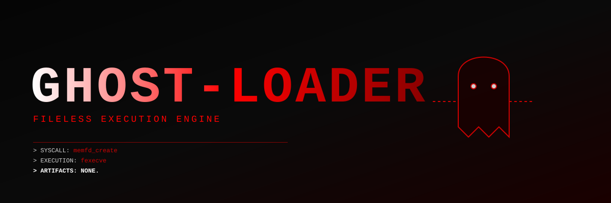

<div align="center">
  
  
  <h1>GHOST-LOADER</h1>
  <p><b>FILELESS EXECUTION ENGINE.</b></p>
  
  
  
  
</div EL>

---

## 👻 WHAT IS GHOST-LOADER?

Traditional security relies on scanning files on the disk. EDRs (Endpoint Detection and Response) monitor the filesystem for malicious binaries. 

**GHOST-LOADER ignores the filesystem completely.**

This is a pure Rust implementation of a fileless execution engine. ItF binary, loads it directly into RAM, creates an anonymous file descriptor using the `memfd_create` syscall, and executes it using `fexecve`. 

The binary runs entirely in memory. There are no files on the disk. The OS sees a process without a file path. Antiviruses are completely blind to it.

## ⚡ CORE CAPABILITIES

*   **Fileless Execution:** Bypasses file-scanning antiviruses and EDR solutions.
*   **memfd_create Syscall:** Creates an anonymous file in RAM, invisible to the filesystem hierarchy.
*   **fexecve Injection:** Executes the payload directly from the memory file descriptor.
*   **Zero Dependencies:** Pure `std`, raw `libc` FFI, and `unsafe` Rust.

## 🛠️ DEPLOYMENT

> ⚠️ **WARNING:** This tool runs arbitrary binaries in memory. Running untrusted payloads will compromise your system.

```bash
# 1. Clone the repository
git clone https://github.com/vantacorehq/ghost-loader.git
cd ghost-loader

# 2. Compile the engine
cargo build --release

# 3. Execute a target binary filelessly
# Example: run /bin/ls entirely from RAM
sudo ./target/release/ghost-loader /bin/ls

[GHOST-LOADER] Initializing fileless execution engine...
[GHOST-LOADER] Target payload: /bin/ls
[+] Payload loaded into memory. Size: 151344 bytes.
[+] Anonymous memory file descriptor created: 3
[+] Payload injected into RAM. No disk artifacts created.
[!] Executing payload directly from RAM...

# (The output of /bin/ls appears here, but no file was ever created on disk)
